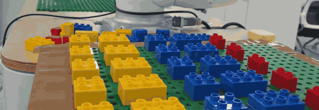
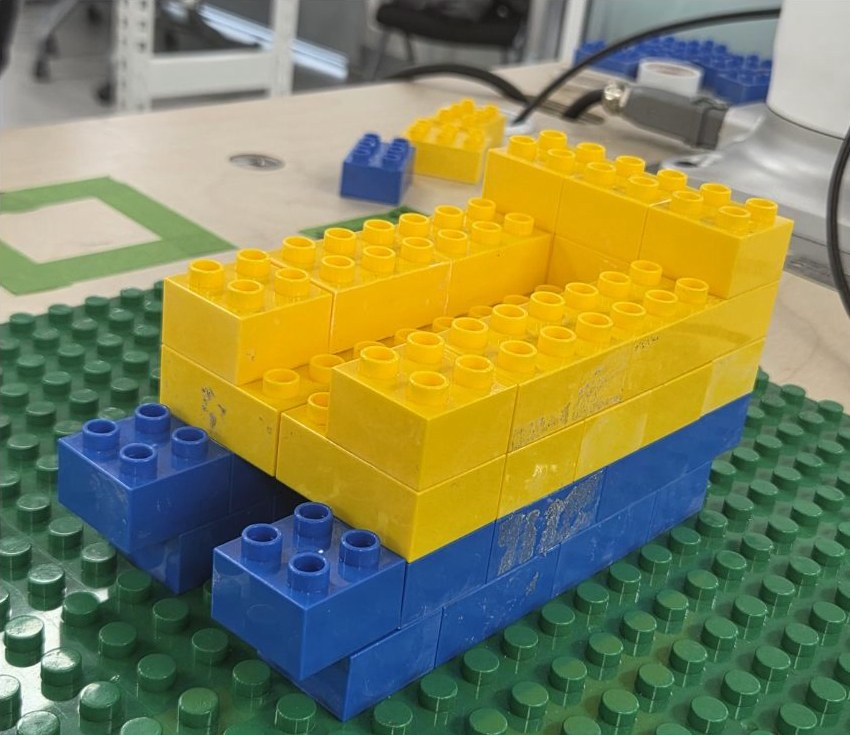
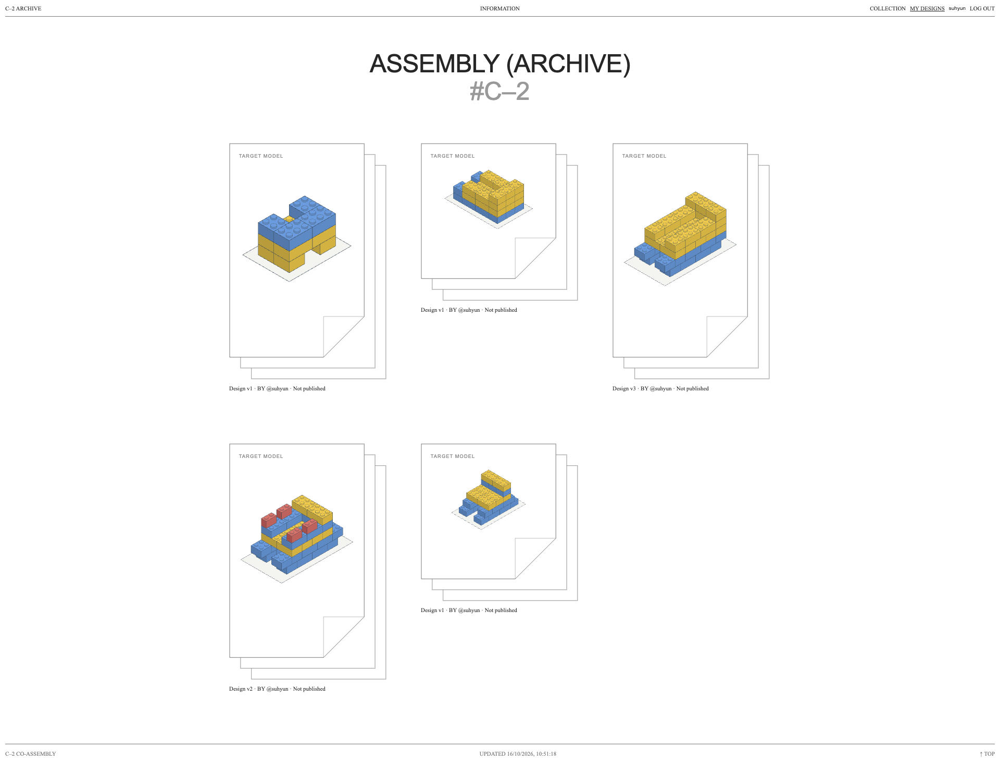
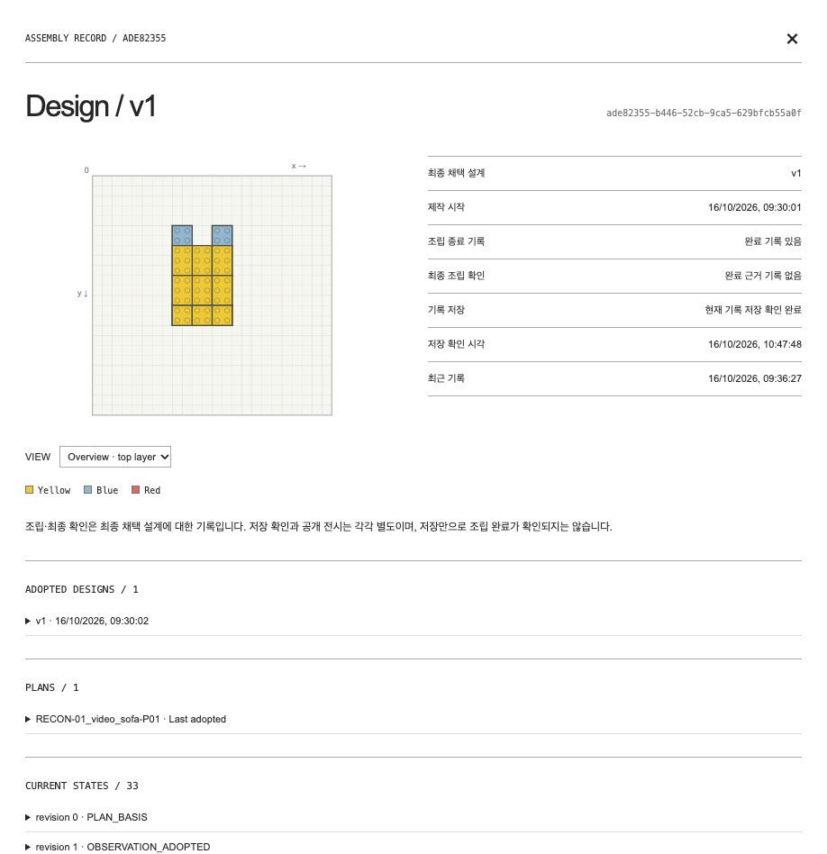

# Adaptive Co-Assembly

https://github.com/user-attachments/assets/26cd168d-b8b1-41d2-8a20-05c863e50b29

설계 대화, 빈 조립판 확인, 블록 파지와 안착, 사람의 개입 감지와 재설계, 조립 재개, 기록 저장과 웹 아카이브까지 한 번의 작업 흐름을 담았습니다(2분 56초).

**대화로 설계하고, 로봇이 조립하는 사람–로봇 협업 LEGO 조립 시스템**

<p align="center">
  <br>
  <sub>공급판에서 블록을 집어 조립판의 목표 위치에 눌러 안착시키는 실제 로봇 동작 (Doosan M0609 + RG2, 배속)</sub>
</p>

<p align="center">
  <b>음성 설계 → 조립 계획 → 로봇 조립 → 비전 검사 → DB · 웹 아카이브를 하나의 서비스로 연결</b><br>
  <b>방향 오차 −1.93° → −0.16° · 재설계 시간 61.5% 단축 · 통합 검사 279개 · 로봇 실행 검사 1,064개 통과</b>
</p>

<p align="center">
  
  
  
  <br>
  <sub>RealSense D435i · YOLO segmentation · OpenCV · PyQt5 · Isaac Sim · MoveIt · Docker</sub>
</p>

사용자가 말로 원하는 의자를 설명하면 생성형 AI가 블록 설계를 만들고, 사용자가 승인한 설계를 기준으로 조립 순서와 사람의 도움이 필요한 단계를 계산합니다. 로봇은 블록을 집어 조립판에 결착하고, 카메라로 실제 상태를 다시 확인한 뒤 다음 단계로 넘어갑니다. 완성한 설계와 작업 이력은 DB에 저장되어 웹 아카이브에서 다시 볼 수 있습니다.

> 두산 로보틱스 ROKEY Boot Camp 9기 · 협동-2 "AI(Computer Vision) 기반 협동 로봇 작업 어시스턴트 구현" · **C-2** 팀 — 이수현(팀장) · 김세은 · 노홍동 · 이시율 · 강사 이충현 · 2026.10.01 ~ 10.16 · 담당 범위는 [팀과 역할](#팀과-역할) 참고

<p align="center">
  <br>
  <sub>대화로 설계한 소파를 사람과 로봇이 함께 조립한 모형</sub>
</p>

## 한눈에

| 문제 | 우리 방법 |
|---|---|
| 색상 · 높이 · 형태가 매번 달라지는 제작 요구를 로봇 작업으로 옮기기 어렵다 | 음성 대화로 설계 후보를 만들고, 미리보기 · 수정 · 승인을 거쳐 실행 목표를 확정합니다 |
| 생성한 설계가 실제로 조립 가능한지, 지금 판 위에 무엇이 놓였는지 함께 봐야 한다 | 지지 조건과 조립 순서를 계산하고, 카메라로 읽은 현재 상태를 반영해 남은 작업만 다시 계획합니다 |
| 로봇 혼자 하기 어려운 단계가 있다 | 사람의 지지 · 조립 도움이 필요한 단계를 계획에 넣고, 요청 · 인계 · 완료 확인을 하나의 흐름으로 처리합니다 |
| 실행 결과를 나중에 추적하기 어렵다 | 작업별 성공 · 실패 · 사람 개입을 기록하고, 사용자별 웹 아카이브에서 다시 확인합니다 |

```text
음성 요구 → 설계 검토 · 승인 → 조립 계획 → 집기 · 결착 → 상태 확인 → 조립 종료 → DB · 웹 기록
                                       (필요하면 사람 도움 요청 · 인계)
```

## 팀과 역할

| 파트 | 담당 | 맡은 것 |
|---|---|---|
| D · Backend / Robot | 이수현(팀장) | 서비스 시스템 · ROS 2 로봇 제어 · 공급판 파지 비전 · HMI · 작업 이력 · DB · 웹앱 · 전체 실행 통합 |
| A · Planning | 김세은 | 조립 순서 · 도움 최소화 알고리즘 설계 · Isaac Sim 운반 경로 · Depth 감시 검증 |
| B · Perception | 노홍동 | RGB-D 전처리 · YOLO 블록 인식 · 보드 높이 보정 · 층 판정 · 조립 상태 검사 |
| C · Voice / Design | 이시율 | STT/TTS 음성 대화 · LLM 생성형 설계 · 설계 Validator · 사용자 승인 · 수정 흐름 |

D가 실행을 조정하고 A · B · C가 각자의 결과를 반환하는 구조입니다.

## 웹 아카이브

조립이 끝난 설계와 작업 이력을 사용자별로 모아 보는 웹앱입니다. 로봇 작업의 결과가 로그 파일로 흩어지지 않고, 사용자가 다시 찾아볼 수 있는 기록으로 남습니다.

<p align="center">
  <br>
  <sub>개인 보관함(MY DESIGNS) — 로그인한 사용자가 만든 설계를 3D 모형 카드로 모아 봅니다</sub>
</p>

- **개인 보관함과 공개 갤러리:** 로그인한 사용자는 자신의 설계를 관리하고, 설계 버전별로 공개 여부(PUBLISH / UNPUBLISH)를 고릅니다. 방문자는 공개된 설계의 3D 모형과 층별 설계도를 볼 수 있습니다.
- **작업별 상세 기록:** 채택한 설계 버전, 조립 계획, 상태 변화(revision) 이력을 한 화면에서 추적합니다.
- **권한 분리:** 개인 작업 이력 · 대화 · 관측 기록은 공개 API에 포함하지 않고, 다른 사용자의 작업 조회 · 저장 · 공개 변경은 거절합니다.
- **원본 보존:** 작업 이벤트를 원본 JSONL과 해시로 보존하고, 필요한 이력만 골라 PostgreSQL 17에 작업별 기록으로 저장합니다. 저장 실패가 로봇 작업을 반복시키지 않도록 저장 재시도와 로봇 동작을 분리했습니다.

```text
작업 이벤트 → 원본 JSONL · 해시 보존 → 필요한 이력 선별 → 작업별 기록 → PostgreSQL → 인증 사용자 웹 조회
```

<details>
<summary>작업 기록 상세 화면</summary>

<p align="center">
  <br>
  <sub>작업 기록 상세 — 층별 설계도, 채택 설계, 계획, 상태 이력</sub>
</p>

</details>

웹앱은 ROS · 카메라 · 로봇 없이 Python과 PostgreSQL만으로 실행합니다. 구현은 [`history/`](history/)에 있고, 실행 방법은 [통합 실행 · DB · 웹 안내](docs/RUN.md)를 따릅니다.

## 핵심 기술

### 대화형 설계 (C)

음성을 Whisper로 받아 요청을 해석하고, LLM이 블록 설계 후보를 JSON으로 생성합니다. Validator가 조립 규칙을 검사한 뒤 사용자가 미리보기를 보고 승인하거나 수정합니다. 조립 중 실제 상태가 기대와 달라지면 사용자 의도를 다시 묻고, 이미 놓인 블록을 유지한 채 남은 설계를 갱신합니다.

- 재설계 호출 구조를 줄여 평균 처리 시간을 **215.3초에서 82.9초로 61.5% 단축**했습니다(같은 5쌍 입력 기준).

### 조립 계획 (A)

승인한 설계에서 이미 조립된 블록을 빼고(`Remaining = Design − Current`), 최소 4 stud 지지 조건을 만족하는 조립 순서를 탐색합니다. 사람의 도움이 필요한 단계 수를 가장 먼저 최소화하도록 순서를 고릅니다. 운반 구간은 MoveIt(RRT-Connect · TOTG · FCL)으로 경로를 만들고, 예상 Depth와 실제 Depth를 비교해 새 장애물을 감시하는 기능을 Isaac Sim에서 개발했습니다.

### 로봇 조립 제어 (D)

중앙 파지부터 이동 · 방향 보정 · 안착 · 재가압 · 반력 정지까지를 하나의 제어 사이클로 연결했습니다.

| 단계 | 방법 |
|---|---|
| 공급판 파지 | 네 모서리의 격자 축과 기준 TCP로 슬롯 위치를 계산하고, 블록 윗면 돌기 배열에서 중심을 구해 중앙을 잡습니다 |
| 방향 보정 | 블록 모서리와 조립판 격자의 방향 차이를 5프레임 중앙값으로 재고, 허용 오차 ±0.5° 안에 들 때까지 작은 각도로 회전합니다 |
| 결착 | 블록을 놓고 그리퍼를 분리한 뒤, 빈 패드로 윗면을 다시 눌러 파지와 결착의 접촉을 분리합니다 |
| 반력 정지 | 재가압 중 0.05초 간격으로 반력을 확인해 45 N 이상이면 하강을 멈추고 정지 상태를 확인합니다 |

- 영상 기반 방향 보정으로 방향 오차를 **−1.93°에서 −0.16°로** 줄였습니다.

### 상태 검사 (B)

RGB-D 영상에서 YOLO segmentation으로 블록 영역을 찾고, 깊이를 16 mm 격자로 변환해 종류 · 색상 · 위치 · 층 · 방향을 읽습니다. 계획이 기대하는 상태와 비교해 일치 · 불일치 · 관측 불가를 구분합니다.

- 5종 블록의 외곽을 Polygon으로 라벨링해 학습했고, 비교 모델 중 Mask mAP50–95가 가장 높은 **YOLO26s-seg(58.71%)**를 선정했습니다.
- 작은 블록에서 윗면 평면 추출이 실패하던 문제를 스터드 중점 Depth 측정으로 바꿔, 층 값 출력을 **48건 중 1건에서 48건 모두**로 개선했습니다.

### 실행 조정과 복구 (D)

A · B · C의 결과를 현재 작업과 대조한 뒤에만 다음 동작으로 넘깁니다.

- **오래된 결과 차단:** 응답의 요청 ID · 세대 · 관측 버전이 현재 작업과 맞는지 확인하고, 정지 후 늦게 도착한 응답은 적용하지 않습니다.
- **검사 결과에 따른 상태 전이:** 일치하면 다음 단계, 불일치하면 사용자 의도 확인, 관측 불가나 오류면 보류로 넘어갑니다.
- **현재 단계 재개:** 통신 · 그리퍼 · 비전 오류가 나면 현재 단계를 보존하고, 연결과 정지 상태를 다시 확인한 뒤 완료한 단계를 반복하지 않고 이어 갑니다.
- **사람 지원 흐름:** 지원 요청 → 준비 확인과 인계 → HOME 복귀 → 사람 완료 확인을 단계로 연결합니다.

<details>
<summary>HMI 화면</summary>

<p align="center">
  <br>
  <sub>HMI — 설계 목표, 현재 구조, 단계별 진행, 공급 상태와 작업 결과 표시 (시험용 합성 관측 데이터 화면)</sub>
</p>

</details>

## 개발 과정

16일 동안 다섯 번의 Round로 범위를 넓혔습니다. 각 Round에서 기능의 연결 범위와 실제 장치에서 확인한 범위를 함께 평가했습니다.

| Round | 목표 | 확인한 결과 |
|---|---|---|
| 0 · 전달형 MVP | 고정 의자의 블록 전달과 사람 결착을 한 흐름으로 연결 | 단위 검사 550건 통과(모의 장치), 37점 IK/FK · 15개 요청 변환 확인 |
| 1 · 직접 조립 | 설계 승인 · 계획 연결, 로봇 직접 결착 시험 | 직접 결착 부분 동작 시험, 로봇 실행 오프라인 검사 1,064개 통과(1개 제외) |
| 2 · 정밀 조립과 인식 | 파지와 결착 분리, 방향 · 높이 · 재설계 처리 개선 | 노랑 2×2 한 사이클 실물 동작 기록, 방향 오차 −1.93° → −0.16°, 45 N 반력 정지 |
| 3 · 실행 연결 | 승인 설계와 계획을 로봇 실행 · 비전 검사에 연결 | 공급 RGB-D 3회 모두 확보, 통합 수정 검사 436개 통과(6개 제외), 실물 한 단계 종료 |
| 4 · 복구와 서비스 통합 | 대화 기반 설계부터 조립 · 복구 · 기록 조회까지 연결 | 대화형 통합 검사 279개 통과(대체 장치), 격리 PostgreSQL 17 저장 · 인증 조회 확인 |

## 설계 원칙

- **성공 상태를 구분합니다.** 명령 완료, 조립 확인, 저장 완료를 서로 다른 상태로 관리합니다. 로봇이 명령을 끝냈다고 조립이 됐다고 보지 않습니다.
- **실패를 성공으로 처리하지 않습니다.** 관측 실패와 저장 실패를 구분해 기록하고, 사람이 화면에서 확인한 진행 상태와 카메라의 실제 판정을 따로 보존합니다.
- **요구와 시험을 V-Model로 잇습니다.** 단위 시험 → 모듈 → 통합 → 실제 장치 순서로 검증 범위를 넓혔습니다.

## 검증 범위와 다음 목표

설계 · 계획 · 실행 · 검사 · 기록을 하나의 서비스로 연결했고, 실물에서는 초기 관측과 블록 단위 로봇 동작(파지 · 이동 · 방향 보정 · 안착 · 재가압)을 확인했습니다. 다음 목표는 제한된 의자 하나를 같은 작업(Job)에서 승인 → 계획 → 연속 조립 → 매 단계 검사 → 최종 검사 → 개인 DB 저장 → 웹 조회까지 로봇 단독으로 반복 성공하는 것입니다.

## 기술 구성

| 영역 | 주요 기술 | 사용 목적 |
|---|---|---|
| 로봇 · 미들웨어 | Ubuntu 24.04, ROS 2 Jazzy, Doosan M0609(DSR), OnRobot RG2(Modbus TCP), Python 3.12 | 협동로봇 실행, 블록 파지 · 빈 패드 가압 |
| 상태 인식 · 영상 | RealSense D435i, OpenCV, YOLO segmentation, Roboflow | RGB-D 상태 관측, 블록 분할 인식, 깊이 · 격자 · ROI 처리 |
| 음성 · 생성형 AI | OpenAI API — gpt-6.1-sol · gpt-4.1-mini · whisper-1 · gpt-4o-mini-tts | 설계 생성 · 수정, 의도 해석, 음성 입출력 |
| 계획 · 계산 | NumPy, SciPy, jsonschema | 조립 순서 · 지지 조건 · 사람 도움 계산과 데이터 검증 |
| 시뮬레이션 · 경로 계획 | Isaac Sim, MoveIt(RRT-Connect · TOTG · FCL) | 운반 경로 생성과 Depth 기반 장애물 감시 개발 |
| 화면 · 데이터 · 서비스 | Qt / PyQt5, PostgreSQL 17, JSONL, Python 웹앱, Docker | HMI, 작업 이력 저장, 사용자별 웹 조회 |
| 개발 · 협업 | Git/GitHub, Slack, Notion, Codex, Claude Code | 브랜치 · PR 협업, AI 코딩 에이전트 활용 |

작업 공간은 24 × 24 stud(16 mm pitch) 조립판과 공급판으로 구성했습니다.

## 실행 방법

로봇 · 카메라 · 외부 API 없이 설계 요청부터 계획 계산, 가상 로봇 진행, 상태 검사까지 확인할 수 있습니다.

<details>
<summary>장치 없이 실행하기</summary>

Ubuntu 24.04 / Python 3.12.3이 기준 환경입니다. GUI 실행에는 Qt 시스템 라이브러리와 화면 환경이 필요합니다.

```bash
git clone --branch main --single-branch https://github.com/suuuhululu/co-human-robot-LEGO-assembly.git
cd co-human-robot-LEGO-assembly

python3 -m venv .venv
source .venv/bin/activate
python3 -m pip install -r requirements.txt

C_DESIGN_USE_LLM=0 python3 -m app.mvp_integration \
  --robot-root ./robot_control_integration \
  --c-mode offline \
  --log-directory logs/mvp-integration
```

외부 API와 DB를 설정하지 않은 환경에서 설계 요청 · 미리보기 승인 · 계획 계산 · 가상 로봇 진행 · 합성 관측 검사를 확인합니다. 실제 LLM · 음성, DB · 웹, 로봇 · 카메라에는 별도 환경 준비가 필요합니다.

- [설치 · 환경 설정](docs/INSTALL.md)
- [통합 실행 · DB · 웹 · 현장 시험](docs/RUN.md)
- [모듈 연결과 책임 범위](docs/INTEGRATION.md)

</details>

## 코드 구조와 문서

`main`은 실행에 필요한 부분만 정리한 묶음이고, 전체 개발 이력과 시험 기록은 최종 통합 브랜치 [`codex/integration-round4`](https://github.com/suuuhululu/co-human-robot-LEGO-assembly/tree/codex/integration-round4)에 있습니다.

```text
co-human-robot-LEGO-assembly/
├── app/                        설계 · HMI · 통합 실행
├── planning_trial/             조립 계획 · 재평가 · 이동 후보
├── perception/                 상태 검사 연결
├── robot_control_integration/  로봇 실행 · 교시 · 설정
├── history/                    DB · 웹 아카이브 · 작업 이력
├── standalone/                 운반 중 Depth 정지 단독 실행
├── scripts/                    현장 실행 보조
├── docs/                       설치 · 운영 · 모듈 연결 · README 이미지
├── requirements.txt            기본 계산 · HMI 의존성
└── requirements-history.txt    DB 의존성
```

| 자료 | 위치 |
|---|---|
| 진행 상황과 검증 기록 | [docs/STATUS.md](https://github.com/suuuhululu/co-human-robot-LEGO-assembly/blob/codex/integration-round4/docs/STATUS.md) (round4) |
| 최종 실행 구성과 검증 | [Round3 게시 스냅샷](https://github.com/suuuhululu/co-human-robot-LEGO-assembly/blob/codex/integration-round4/docs/D_ROUND3_PUBLISHED_RUNTIME_20261015.md) (round4) |
| 웹 아카이브 · DB 실행 안내 | [D_WEB_HISTORY_RUN.md](https://github.com/suuuhululu/co-human-robot-LEGO-assembly/blob/codex/integration-round4/docs/D_WEB_HISTORY_RUN.md) (round4) |
| 보존 기준 | [통합 보존 기준](https://github.com/suuuhululu/co-human-robot-LEGO-assembly/tree/archive/integration-20261013-ebeeef2) · [이전 main](https://github.com/suuuhululu/co-human-robot-LEGO-assembly/tree/archive/main-20261013-afd75d0) · [파일 보존 명세](https://github.com/suuuhululu/co-human-robot-LEGO-assembly/blob/codex/archive-runtime-20261013/ARCHIVE_MANIFEST.json) |
